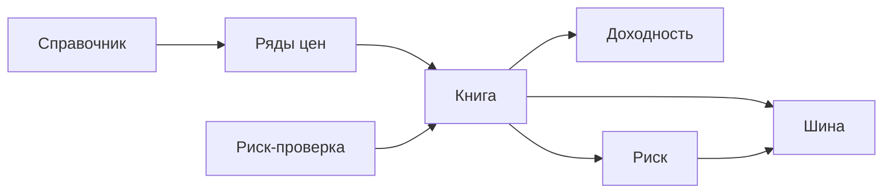

# Схема ядра

Промпт 31. Это карта уже существующих контуров. Новых расчётов здесь нет.

Позиция пишется в книгу. Цена для оценки берётся из рыночных данных. Доходность и риск читают книгу, а не считают свою копию. Бумажный и реальный режимы в книге разделены. Реальный режим выключен.

Живая матрица связей: [WIRING_MATRIX.md](../qa/WIRING_MATRIX.md).
Словарь: [entity-dictionary.md](entity-dictionary.md).
Каталог сервисов: [service-catalog.md](service-catalog.md).
